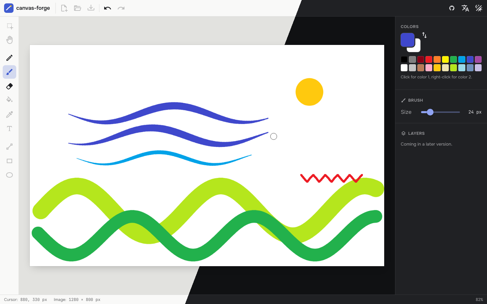

# canvas-forge

[Русская версия](README.ru.md)

[](https://github.com/it2konst/canvas-forge/actions/workflows/ci.yml)

A Paint-style image editor that runs entirely in the browser. Familiar tools, a classic palette and the shortcuts you expect, in a calm interface that works by day and by night. Images stay on your device and are never uploaded anywhere.

Written from scratch with Vue 3 and TypeScript.



> **Work in progress.** You can already draw with the pencil, brush and eraser, with pen pressure and undo. Shapes, fill, files and more arrive in the next stages of the [roadmap](#roadmap).

## Features

**Ready**

- Pencil: hard-edged square pixels with no anti-aliasing, good for pixel art
- Brush: round and anti-aliased, smoothed with curves so fast strokes have no corners; pen pressure sets the width
- Eraser: paints with color 2, like in Paint
- Left button paints with color 1, right button with color 2
- Undo and redo for every stroke (up to 100 steps within a 256 MB budget); Escape cancels the stroke in progress
- The cursor shows the tool size at the current zoom, snapped to the pixel grid for the hard tools
- Smooth input: every pointer sample the hardware reports is used, strokes continue past the edge of the canvas
- Sharp on HiDPI screens: the canvas matches physical pixels
- Editor layout: tool rail, properties panel, canvas area and status bar
- 11 tools in three groups, each with a single-key shortcut; tools that are not implemented yet are shown disabled
- Color 1 and color 2 with a swap button, and the classic 20-color palette: click for color 1, right-click for color 2
- Brush size control
- Status bar with the cursor position in image pixels, the image size and the zoom level
- The image fits the screen at any window size
- Light, dark and system themes, tuned for long sessions: neutral grey chrome that does not tint your picture, no pure white or black, softened text contrast, every accent passes WCAG AA
- English and Russian interface; the browser language is picked on the first visit
- Responsive layout down to phone width: on narrow screens the properties panel becomes a drawer
- Strict Content-Security-Policy on deploy

**Planned**

- Line, rectangle, ellipse, flood fill, color picker and text
- Zoom and pan, resize the canvas
- Open, paste and drop images; save as PNG, JPEG or WebP; autosave in the browser
- Selection: move, copy, cut, paste, crop
- Layers
- Offline support and install as an app (PWA)

## Privacy and security

- Everything happens in the browser: no server, no accounts, no analytics, no cookies.
- Only the theme and language choices are kept, in `localStorage`.
- `v-html` is forbidden by the lint config, so user content is never injected as raw HTML.
- The deployed site sends a strict CSP: scripts, fonts and connections are limited to its own origin.

## Tech stack

| Area      | Choice                                                |
| --------- | ----------------------------------------------------- |
| Framework | Vue 3 (Composition API, `<script setup>`), TypeScript |
| Build     | Vite                                                  |
| UI        | Vuetify 4, Material Design Icons as SVG paths         |
| State     | Pinia, VueUse                                         |
| i18n      | vue-i18n, connected to Vuetify through its adapter    |
| Fonts     | Onest and JetBrains Mono, self-hosted via Fontsource  |
| Drawing   | Canvas 2D, Pointer Events with pen pressure           |
| Quality   | ESLint (flat config), Prettier, vue-tsc               |
| Tests     | Vitest, GitHub Actions CI                             |
| Packages  | pnpm                                                  |
| Hosting   | Vercel                                                |

## Getting started

Requires Node.js 22.15 or newer and pnpm 10.

```bash
pnpm install
pnpm dev
```

| Script              | What it does                        |
| ------------------- | ----------------------------------- |
| `pnpm dev`          | Start the dev server                |
| `pnpm build`        | Type-check and build for production |
| `pnpm preview`      | Serve the production build locally  |
| `pnpm lint`         | Lint and auto-fix                   |
| `pnpm lint:check`   | Lint without changing files         |
| `pnpm format`       | Format the project with Prettier    |
| `pnpm format:check` | Check formatting                    |
| `pnpm type-check`   | Run vue-tsc                         |
| `pnpm test`         | Run the unit tests once             |
| `pnpm test:watch`   | Run tests on every change           |
| `pnpm coverage`     | Tests with a coverage report        |

## Tests

Unit tests run with Vitest in Node and on every push in GitHub Actions. The drawing engine is plain TypeScript, so its core is tested without a browser:

- geometry: rectangle helpers and whole-pixel lines with no gaps
- history: undo and redo order, the redo branch, step and memory limits
- tools: pencil and eraser stamps, brush dots, the area each stroke reports, pressure thinning

## Keyboard shortcuts

| Keys                     | Action            |
| ------------------------ | ----------------- |
| `Ctrl+Z`                 | Undo              |
| `Ctrl+Y`, `Ctrl+Shift+Z` | Redo              |
| `Esc`                    | Cancel the stroke |

On macOS use `Cmd` instead of `Ctrl`. Tools:

| Key | Tool   | Key | Tool         |
| --- | ------ | --- | ------------ |
| `S` | Select | `G` | Fill         |
| `H` | Hand   | `I` | Color picker |
| `P` | Pencil | `T` | Text         |
| `B` | Brush  | `L` | Line         |
| `E` | Eraser | `R` | Rectangle    |
|     |        | `O` | Ellipse      |

## Project structure

```text
src/
  components/
    layout/      header, tool rail, canvas area, status bar, theme and language menus
    panels/      properties panel and its sections (colors, brush, layers)
  composables/   theme and language sync, canvas input, keyboard shortcuts
  engine/        drawing engine in plain TypeScript: document, input, strokes, history
    tools/       pencil and eraser (hard square), brush (round, pressure)
  i18n/          vue-i18n setup and EN/RU messages
  plugins/       Vuetify setup
  stores/        Pinia: editor state, preferences, UI
  theme/         light and dark palettes
  tools/         tool catalog, which engine tool backs each one, default palette
  icons.ts       every icon the app uses, in one place
```

## Roadmap

1. ~~Project shell: layout and panels, themes, EN/RU~~ ✓
2. ~~Drawing engine: canvas, pencil, brush, eraser, pen pressure, undo and redo, tests and CI~~ ✓
3. Shapes and fill: line, rectangle, ellipse, flood fill, color picker, text
4. Zoom and pan, canvas size
5. Files: open, paste, drag and drop, save as PNG / JPEG / WebP, autosave
6. Selection: move, copy, cut, paste, crop
7. Layers
8. PWA: offline, install, open images with the app

## Author

Made by [it2konst](https://github.com/it2konst). Issues and suggestions are welcome in [GitHub Issues](https://github.com/it2konst/canvas-forge/issues).

## License

[MIT](LICENSE)
