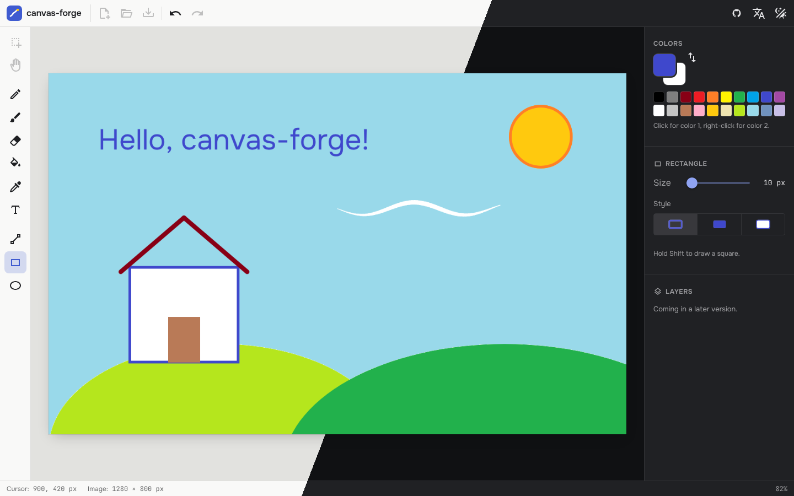

# canvas-forge

[English version](README.md)

Графический редактор в духе Paint, который работает прямо в браузере. Привычные инструменты, классическая палитра и знакомые горячие клавиши в спокойном интерфейсе, в котором удобно и днём, и ночью. Изображения остаются на вашем устройстве и никуда не загружаются.

Написан с нуля на Vue 3 и TypeScript.



> **В разработке.** Оболочка редактора готова: раскладка, панели, темы и языки. Рисование появится на следующих этапах [плана](#план).

## Возможности

**Готово**

- Раскладка редактора: панель инструментов, панель свойств, область холста и строка состояния
- 11 инструментов в трёх группах (выделение и навигация, рисование, фигуры), у каждого своя клавиша
- Цвет 1 и цвет 2 с кнопкой обмена и классическая палитра из 20 цветов: клик выбирает цвет 1, правый клик выбирает цвет 2
- Размер кисти
- Строка состояния: позиция курсора в пикселях изображения, размер изображения и масштаб
- Изображение вписывается в экран при любом размере окна
- Светлая, тёмная и системная темы для долгой работы: нейтрально-серый интерфейс, который не искажает цвета рисунка, без чистого белого и чёрного, со смягчённым контрастом текста; все акцентные цвета проходят WCAG AA
- Интерфейс на русском и английском; при первом визите язык берётся из браузера
- Адаптивная раскладка вплоть до ширины телефона: на узких экранах панель свойств выезжает сбоку
- Строгая Content-Security-Policy на продакшене

**В планах**

- Карандаш, кисть и ластик с учётом нажима пера, отмена и повтор действий
- Линия, прямоугольник, эллипс, заливка, пипетка и текст
- Масштаб и перемещение холста, изменение размера
- Открытие, вставка и перетаскивание изображений; сохранение в PNG, JPEG или WebP; автосохранение в браузере
- Выделение: перемещение, копирование, вырезание, вставка, обрезка
- Слои
- Работа офлайн и установка как приложения (PWA)

## Приватность и безопасность

- Всё происходит в браузере: без сервера, аккаунтов, аналитики и cookie.
- Сохраняются только выбранные тема и язык, в `localStorage`.
- `v-html` запрещён конфигурацией линтера, поэтому пользовательский контент никогда не вставляется как HTML.
- Сайт отдаёт строгую CSP: скрипты, шрифты и сетевые запросы разрешены только со своего домена.

## Технологии

| Область   | Выбор                                                 |
| --------- | ----------------------------------------------------- |
| Фреймворк | Vue 3 (Composition API, `<script setup>`), TypeScript |
| Сборка    | Vite                                                  |
| UI        | Vuetify 4, иконки Material Design в виде SVG-путей    |
| Состояние | Pinia, VueUse                                         |
| i18n      | vue-i18n, подключён к Vuetify через адаптер           |
| Шрифты    | Onest и JetBrains Mono, локально через Fontsource     |
| Качество  | ESLint (flat config), Prettier, vue-tsc               |
| Пакеты    | pnpm                                                  |
| Хостинг   | Vercel                                                |

## Запуск

Нужны Node.js 22.15 или новее и pnpm 10.

```bash
pnpm install
pnpm dev
```

| Скрипт              | Что делает                                 |
| ------------------- | ------------------------------------------ |
| `pnpm dev`          | Запускает dev-сервер                       |
| `pnpm build`        | Проверяет типы и собирает продакшен-сборку |
| `pnpm preview`      | Отдаёт продакшен-сборку локально           |
| `pnpm lint`         | Линтинг с автоисправлением                 |
| `pnpm lint:check`   | Линтинг без изменения файлов               |
| `pnpm format`       | Форматирует проект через Prettier          |
| `pnpm format:check` | Проверяет форматирование                   |
| `pnpm type-check`   | Запускает vue-tsc                          |

## Горячие клавиши

| Клавиша | Инструмент | Клавиша | Инструмент    |
| ------- | ---------- | ------- | ------------- |
| `S`     | Выделение  | `G`     | Заливка       |
| `H`     | Рука       | `I`     | Пипетка       |
| `P`     | Карандаш   | `T`     | Текст         |
| `B`     | Кисть      | `L`     | Линия         |
| `E`     | Ластик     | `R`     | Прямоугольник |
|         |            | `O`     | Эллипс        |

## Структура проекта

```text
src/
  components/
    layout/      шапка, панель инструментов, холст, строка состояния, меню темы и языка
    panels/      панель свойств и её разделы (цвета, кисть, слои)
  composables/   синхронизация темы и языка, горячие клавиши инструментов
  i18n/          настройка vue-i18n и тексты EN/RU
  plugins/       настройка Vuetify
  stores/        Pinia: состояние редактора, настройки, интерфейс
  theme/         светлая и тёмная палитры
  tools/         каталог инструментов и палитра по умолчанию
  icons.ts       все иконки приложения в одном месте
```

## План

1. ~~Оболочка: раскладка и панели, темы, EN/RU~~ ✓
2. Движок рисования: холст, карандаш, кисть, ластик, нажим пера, отмена и повтор
3. Фигуры и заливка: линия, прямоугольник, эллипс, заливка, пипетка, текст
4. Масштаб и перемещение, размер холста
5. Файлы: открытие, вставка, перетаскивание, сохранение в PNG / JPEG / WebP, автосохранение
6. Выделение: перемещение, копирование, вырезание, вставка, обрезка
7. Слои, тесты и CI
8. PWA: офлайн, установка, открытие изображений приложением

## Автор

Сделано [it2konst](https://github.com/it2konst). Вопросы и предложения пишите в [GitHub Issues](https://github.com/it2konst/canvas-forge/issues).

## Лицензия

[MIT](LICENSE)
